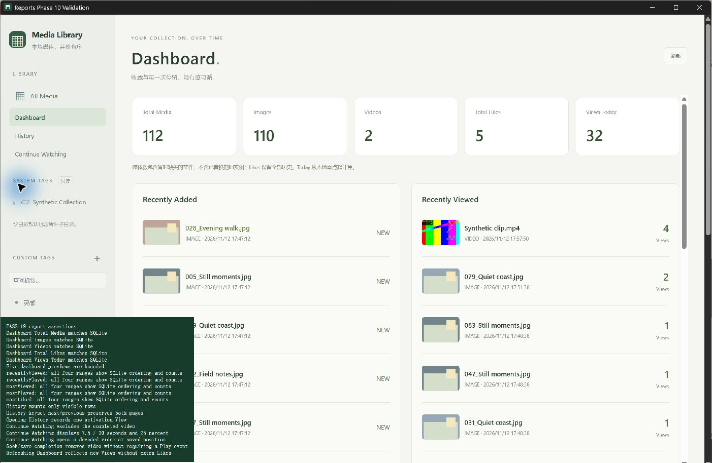
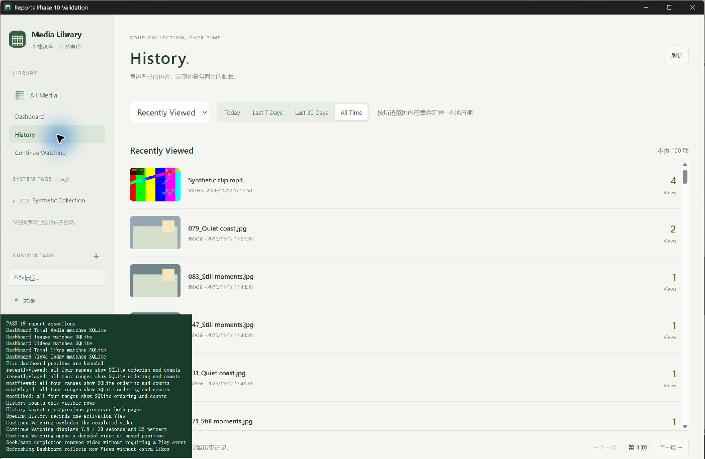

# Phase 10 验证记录

2026-11-12，Windows x64 / WebView2。Phase 10 已验收，完成后停止。范围为 History、Continue Watching、Dashboard；仅使用临时 SQLite 与合成媒体，没有访问私人媒体或正式应用数据库。

实际工具链：rustc/cargo 1.99.1、Node 24.22.2、npm 11.19.1、FFmpeg/ffprobe 9.0.2。Cargo 使用 `.tools/cargo-validation`、`RUSTUP_AUTO_INSTALL=0` 和 locked/offline；真实工具路径通过当前进程 `MEDIA_MANAGER_FFMPEG_DIR` 提供。未升级依赖或改动锁文件。

## 最终自动测试

| 实际执行命令 | 最终结果 |
| --- | --- |
| `npm.cmd test` | 55/55，0 skipped |
| `npm.cmd run test:dev` | 1/1 |
| `npm.cmd run build` | 严格 TypeScript（含 UI 夹具）和 Vite production build 通过 |
| `cargo test --locked --offline -- --include-ignored --nocapture` | desktop 85/85，0 ignored，包含真实 FFmpeg 用例 |
| `cargo test --no-default-features --locked --offline -- --include-ignored --nocapture` | 无桌面 85/85，0 ignored，包含真实 FFmpeg 用例 |
| `cargo clippy --all-targets --locked --offline -- -D warnings` | 通过 |
| `cargo clippy --all-targets --no-default-features --locked --offline -- -D warnings` | 通过 |
| `cargo fmt --all -- --check`、`git diff --check` | 通过，最终文档后复查 |

每种 Rust 配置执行相同的 85 项 Windows 用例，不合计为 170 个独立用例。相较 Phase 9 新增 6 项报表集成场景及 1 项 migration 回归；Unix 条件用例未在 Windows 执行。原始输出在 `.tools/validation/phase10/`，最终日志使用 `*-final.log`。

新增覆盖包括：事件时间范围包含起点/排除终点、范围内 COUNT/MAX 排序、并列与缺失媒体身份；当前版本进度、95%/短片阈值/未知时长、旧 completed 位兼容、seek 保存不产生 Play；游标签名/代次/进度变化失效、输入上限、查询失败与恢复；空 Dashboard、同一快照内汇总与预览；150ms 并发写锁、幂等重试和计数隔离。前端校验本地 7/30 日边界及 DST、IPC 数值/页上限、未知进度和十万项虚拟行窗口。

v9→v10 由正式 migration runner 执行，保留旧日志、Counter Cache 和恢复行；备份为 schema=9 且数据一致，升级后重开不重复迁移，foreign_key_check 无错误。v10 仅追加读索引、进度视图和报表代次，未修改旧 migration。

## 100,000 媒体与事件实测

真实临时库包含 100,000 个视频 ID、100,000 条 View 及 100,000 个当前恢复状态。Most Viewed 遍历 500 个 keyset 页，每页 200，精确返回全部 ID，无重复/遗漏；SQLite 的三类时间查询 EXPLAIN 确认使用覆盖索引范围读取。

| 最终配置 | History p50 | History p95 | 末页 | Dashboard | Continue Watching 首页 |
| --- | ---: | ---: | ---: | ---: | ---: |
| Desktop | 120.322 ms | 168.621 ms | 68.711 ms | 271.423 ms | 约 0.89 ms |
| 无桌面 | 125.891 ms | 165.202 ms | 73.039 ms | 278.394 ms | 约 0.91 ms |

以上为本机合成负载实测，执行期间存在其他构建/回归负载，不代表所有硬件或巨大单媒体事件历史的性能保证。时间段聚合仍由 SQLite 扫描范围并 GROUP BY，深页会重新聚合；没有将事件搬到 Rust/前端排序，也没有宣称聚合查询恒定时间。SQLite temp_store=FILE、连接页缓存 4 MiB，Rust 每页最多收集 limit+1；未测量全进程峰值内存。

首轮专项为 History p95=349.892ms、Dashboard=576.015ms、Continue Watching=482.687ms。发现续播未充分利用进度索引后，改为部分索引驱动联接，以上最终结果来自修复后的完整套件。

## 真实桌面验收与失败修复

使用 Computer Use 原生窗口操作，独立 identifier `com.mediamanager.validation.phase10` 和 `.tools/validation/phase10/runtime`。夹具由 `seed_library_validation --phase10` 通过正式 migration/scanner/metadata/thumbnail 服务创建：110 张图片、两段 30 秒 H.264 视频，历史分布在今天、3 天、14 天和 40 天前。历史事件是独立合成夹具，不是产品写入口。

`tests/ui/reports.html?run=1` 导入正式产品 App，使用真实 SQLite/Tauri IPC，没有 mock 产品 API。最终观察到 **PASS 19 report assertions**：

- 五个 Dashboard 汇总值及五组有界预览。
- 五类 History 各验证四个时间范围的实际顺序和计数。
- 100＋12 项跨页、返回前页及仅挂载虚拟窗口。
- 打开 History 仅产生一个 activation View。
- Continue Watching 排除完成视频，显示 7.5/30 秒与 25%，真实解码并恢复到 7.5 秒。
- seek 到 29 秒后立即关闭，保存完成并从续播移除；Dashboard 反映两次新增 View，Like/Play 不增加。

另用原生输入点击 History 侧栏入口，观察完整列表、时间控件和页脚正常显示。

首轮两种完整配置各 84/84 后，桌面在立即 seek→关闭时暴露 `database is locked`，17 项通过但关闭保存失败，该轮不计为通过。定向回归让另一连接持有 150ms 写锁：旧 DEFERRED 保存 0/1（DatabaseBusy），改为在读取 owner/CAS 前 BEGIN IMMEDIATE 后 1/1。未删除或跳过断言，保留重试幂等、版本和事件边界，随后两种完整配置重新通过各 85/85，真实桌面 19 项重跑通过。重跑只通过正式 API 恢复合成视频的起始进度，不删除既有事件。

## 退出核对与清理

最终 Alt+F4 后 desktop CLI exit 0，测试窗口清单为空，1420 Listen 数量为 0，截图 JavaScript kernel 已重置。未批量终止用户浏览器/Node 或更改系统设置。

退出后只读 SQLite 与源文件核对：112 媒体、5 Like、116 View、4 Play；其中 history View=4（两轮各两次），seed 的 normal_viewer View=112。全部计数与最近时间缓存相对日志聚合 **0 差异**；FK 检查无异常、quick_check=ok。合成视频恢复位置为 29/30 秒，当前进度投影 completed=1；另一视频为 28.5/30、completed=1。全过程未新增 qualified Play。按扫描时 quick-v1 算法重算 112 个合成原件，全部指纹一致。

本次通过范围为 Windows 开发配置、前端生产构建及上述规模负载；未新增正式 release 打包、跨平台/长期运行或会话历史恢复验收。Phase 1 浏览器专项历史限制保留，不把它冒充本轮通过或本轮阻塞。Phase 10 到此停止。
