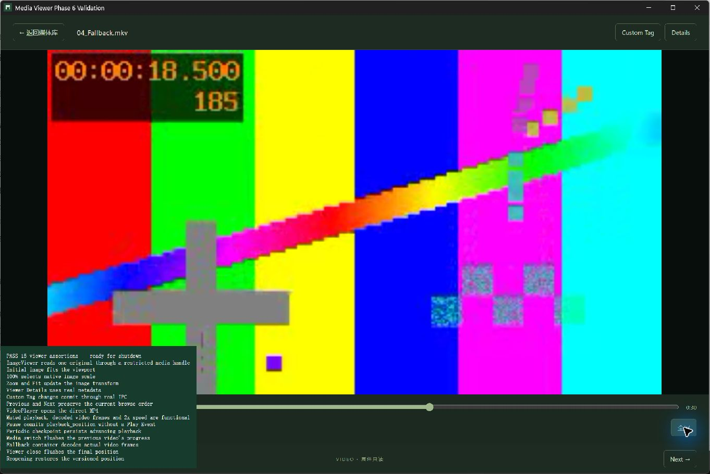
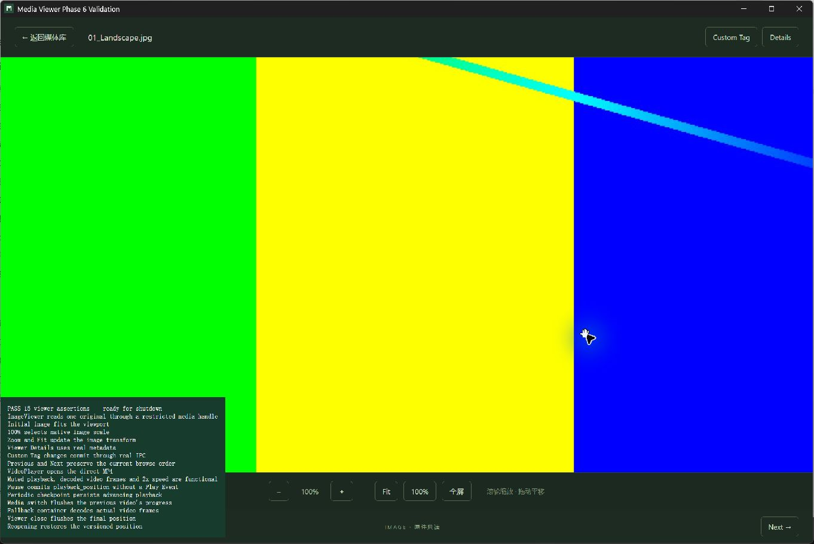

# Phase 6 验证记录

日期：2026-11-08。平台：Windows x64、WebView2，Node 24.22.2、Rust 1.99.1，FFmpeg/ffprobe 9.0.2。实现范围为 ImageViewer、VideoPlayer 和独立 playback_position；没有加入 Play Event、completed 资格判断或播放计数写入。

## 自动测试

| 实际执行命令 | 结果 |
| --- | --- |
| `npm.cmd test` | 42/42，含前端进度串行/重试、图片变换、DTO、架构边界和数据库规则。 |
| `npm.cmd run build` | 严格 TypeScript 检查和 Vite production build 通过。 |
| `npm.cmd run test:dev` | 1/1，Vite 监听与 Cargo 输出隔离。 |
| `cargo test --locked --offline -- --include-ignored` | 默认 desktop 配置 54/54，0 ignored。 |
| `cargo test --no-default-features --locked --offline -- --include-ignored` | 无桌面配置 54/54，0 ignored。 |
| `cargo clippy --all-targets --locked --offline -- -D warnings` | 通过。 |
| `cargo clippy --all-targets --no-default-features --locked --offline -- -D warnings` | 通过。 |
| `cargo fmt --all -- --check`、`git diff --check` | 通过。 |

Cargo 使用工作区已有 `.tools/cargo-validation` 缓存及 locked/offline；实际 FFmpeg 测试设置 `MEDIA_MANAGER_FFMPEG_DIR=E:/MediaManager/.tools/ffmpeg/ffmpeg-9.0.2-essentials_build/bin`。一次针对 viewer 的早期重跑漏设此变量，真实工具测试报告 program not found；恢复上述环境后，两种配置的完整测试全部通过。

新增后端测试覆盖：资源 token 撤销、只读/路径隔离、HEAD/Range 上限、移动保留资源、内容版本及同路径替换隔离、owner 接管/CAS/序号幂等、事务回滚/非法数值、缺少 FFmpeg、源文件消失、真实 Remux/Proxy/缓存复用、重载释放会话额度。既有增量扫描、损坏文件隔离、migration、事件事务及 100,000 项分页测试一并执行。

## 真实桌面验收

使用 Computer Use 原生窗口操作和真实 Tauri IPC；测试入口 `tests/ui/viewer.html?run=1` 导入产品 `src/main.tsx`，没有替换产品 API。`seed_viewer_validation` example 仅在工作区 `.tools/validation/phase6` 生成夹具，已有数据库拒绝覆盖。独立 identifier 为 `com.mediamanager.validation.phase6`，appDirectoriesOverride 指向该目录的 runtime；未使用私人媒体或正式应用数据。

夹具包括两张 3200×1800 JPEG、一段 H.264/AAC MP4、一段 MPEG-4/AAC MKV（各 30 秒），以及一张故意损坏的 PNG。原生回归观察到 **PASS 15**，覆盖：

- 受限资源协议读取当前原图、初始 Fit、100%、zoom/Fit、真实 metadata Details 和 Custom Tag IPC。
- 按当前浏览顺序 previous/next，以及 Direct 视频的静音、2× 速度、实际解码视频帧。
- pause、5 秒周期 checkpoint、媒体切换、viewer close 保存，以及重新打开恢复进度。
- MKV 兼容性回退后真正解码视频画面。修复 WebView 只解码音频却不报错的黑屏路径；不能仅以时间轴推进判断视频可用。

测试脚本等待目标文件名、资源 readyState、视频尺寸及导航按钮可用，避免把上一个媒体的就绪状态当作新媒体成功。合成画面另用 canvas 检查解码像素，防止音频播放产生假阳性；产品资源协议允许受限 CORS，video 使用 anonymous 模式。

手工可信输入另验证：100% 下拖动图片后可见裁切位置改变，图片和视频均能进入全屏并用 Escape 退出。

## 退出保存与清理

视频恢复到 18.5 秒后，以原生鼠标点击时间轴到 **24.5 秒**，随后立即 Alt+F4 关闭应用。桌面 CLI 正常退出（exit 0）；退出后只读 SQLite 检查确认：

- `04_Fallback.mkv` 的 `media.playback_position = 24.5`，Direct 视频保存为约 16.03 秒，图片仍为 0。
- `play_events`、`view_events`、`like_events` 行数全部为 0；全部 5 项的 `play_count = 0`。
- 按扫描时相同 quick-v1 算法重算 5 个合成源文件指纹，全部与数据库记录一致；这些小于 3 MiB 的夹具会校验完整文件内容。

测试 Tauri 窗口清单为空；1420 端口只读查询无连接/监听记录。开发服务随桌面进程退出，最终重置截图 kernel 释放捕获会话，避免遗留屏幕边框。未批量终止用户的 Node/Chrome 进程。

本轮 Windows 验收通过。跨平台 codec/HDR/字幕/多音轨与发布包 FFmpeg 许可矩阵未在本轮验收；强杀或断电仍可能丢失最后一个 checkpoint 间隔，正常关闭会最多等待 3 秒尽力保存。Phase 6 到此停止。
