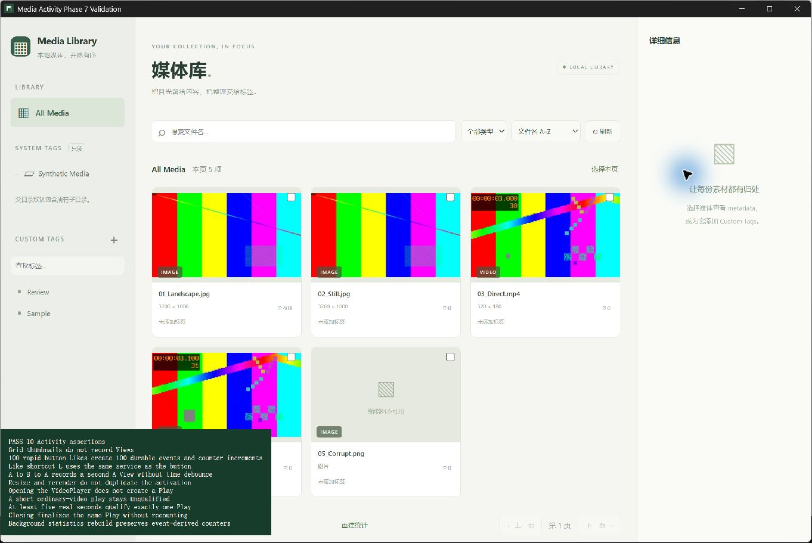
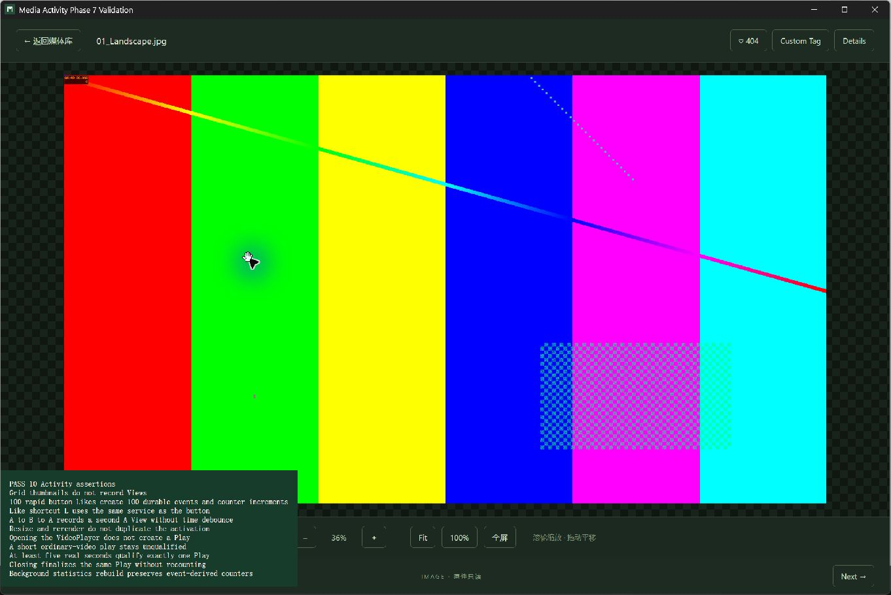

# Phase 7 验证记录

日期：2026-11-09（验收跨越 11-08/11-09）。平台：Windows x64 / WebView2；Node 24.22.2、Rust 1.99.1，真实 FFmpeg/ffprobe 9.0.2。

范围：累加 Like、Activation View、Qualified Play、一次终结补全、Event Log 驱动的 Counter Cache 与后台重建。保留原件只读、标签/身份/版本/播放进度边界；不实施 Quick Browser 或 History 页面。

## 自动测试

| 实际执行命令 | 最终结果 |
| --- | --- |
| `npm.cmd test` | 47/47 通过。 |
| `npm.cmd run build` | 严格 TypeScript 与 Vite production build 通过。 |
| `npm.cmd run test:dev` | 开发监听回归 1/1 通过。 |
| `cargo test --locked --offline -- --include-ignored --nocapture` | 默认 desktop 配置 66/66 通过，无 ignored。 |
| `cargo test --no-default-features --locked --offline -- --include-ignored --nocapture` | 无桌面配置 66/66 通过，无 ignored。 |
| `cargo clippy --all-targets --locked --offline -- -D warnings` | 通过。 |
| `cargo clippy --all-targets --no-default-features --locked --offline -- -D warnings` | 通过。 |
| `cargo fmt --all -- --check`、`git diff --check` | 通过。 |

早期 Node 测试发现 strip-only 不支持参数属性及过期 capability 白名单，已修正并完整重跑。最后加入 COMMIT 故障回归、校准短片 qualification（不额外要求 95% 观看覆盖率）后，两种 Rust 配置再次完整通过。95% 只用于 completed，不代替真实 ended 资格。

Cargo 使用已有 `.tools/cargo-validation`，设置 `RUSTUP_AUTO_INSTALL=0`，以 locked/offline 执行；真实工具测试设置 `MEDIA_MANAGER_FFMPEG_DIR=E:/MediaManager/.tools/ffmpeg/ffmpeg-9.0.2-essentials_build/bin`。没有增加依赖或手改锁文件。

新增 Rust activity 测试覆盖：

- 4 个并发调用者各 25 次 Like，100 个主动动作恰好 100 条事件及缓存 100；同请求重试不再计，冲突请求拒绝。
- 事件/Counter Cache/sequence/rebuild delta 同事务回滚；注入 delta、View counter、Play counter 故障后工作状态也可原请求重试。另以 deferred FK 注入 COMMIT 失败，验证事件与计数均回滚。
- 相同 activation 20 次调用只记录一次，A→B→A 为三次，来源及 viewed_at 正确，陈旧 ordinal 和冲突 activation 拒绝。
- 打开无 Play；有效五秒才 INSERT；2× 使用真实经过时间；pause/waiting/seek/大段缺失证据不冒充观看；重复 evidence 不重复计数。恰好五秒和未知 duration 走普通规则。
- 短片必须真实 ended，单纯恢复/seek 到尾不 qualify，处理浏览器 pause-before-ended。completed 使用批准公式；关闭重复终结不再计数。
- 统一及分 kind 重建、零事件归零/时间置 NULL、并发 delta、发布后事件、取消、checkpoint 重启续跑、异常会话仅补全最后持久化证据。

前端新增测试覆盖 activation 身份、A→B→A、序号边界串行、失败保留每个边界及同 payload 重试、活动响应契约；既有进度/虚拟网格/迁移/不可变事件/计数测试全部保留。

## 规模实测

临时数据库合成 **100,002 媒体、2,502 Like 事件**；先将缓存改错，再重建。每一步检查实际 publish_cursor 覆盖的媒体数不超过 100；扫描日志每批最多 1000。首轮 1,009 步，重建用时 22.731 秒；随后完整 desktop 复测为 23.892 秒（不含夹具生成）。每批之间仍可插入前台 Like。

测试分别在已发布媒体、尚未发布媒体插入新事件，完成后所有 COUNT 与缓存一致，末项 2,501 Likes，无漏计/双计；派生 base/delta 清空。此为本机合成负载结果，不代表所有硬件/磁盘或巨大单媒体事件历史的性能承诺。

既有 100,000 媒体/1000 页 keyset 查询本轮 desktop 实测 p50=0.903ms、p95=1.427ms、末页=0.802ms；保持虚拟网格和 lazy thumbnails。

## 真实桌面验收

使用 [Computer Use 技能](C:/Users/19228/.codex/plugins/cache/openai-bundled/computer-use/26.1103.32239/skills/computer-use/SKILL.md) 原生窗口操作。独立 identifier `com.mediamanager.validation.phase7`、appDirectoriesOverride `.tools/validation/phase7/runtime`，夹具由 `cargo run --example seed_viewer_validation -- --phase7` 生成；已有数据库拒绝覆盖，未使用私人媒体。

`tests/ui/activity.html?run=1` 导入产品入口，使用真实 SQLite/Tauri IPC，未替换产品 API。观察到 **PASS 10**：

1. 缩略图网格不产生 View。
2. 100 次快速 Like 按钮点击逐条保存。
3. L 快捷键与按钮共用服务。
4. A→B→A 立即返回可新增 A View。
5. resize/rerender 不重复 View。
6. 打开 VideoPlayer 不产生 Play。
7. 普通视频短播放不 qualify。
8. 累计至少五秒真实播放后只产生一个 Play。
9. 关闭只终结同一 Play，不再加数。
10. 后台统一重建保持日志导出计数一致。

另以原生系统按键 `l` 验证计数由 403 增至 404：

早期桌面回归发现 Window 类型事件目标没有 closest，以及主动 Like 后立即导航可能沿用旧代次；已修复，并等待真实界面/导航提交后重跑。测试按本次开始时的 baseline 验证增量，不删除已提交的历史日志；多次开发重跑后的累计总数不是单轮 100 次结果。

退出后只读查询结果：404 Like、13 View、2 Play；五项媒体的全部计数及 last_viewed_at/last_played_at 与日志聚合 **0 差异**。两条 Play 分别记录约 5.397 / 5.422 秒实际观看，最后位置 29/30 秒，completed=1，ended_at 已补全、end_reason=close。关闭没有追加第三条事件。按扫描时 quick-v1 算法重新校验五个合成原件（均小于 3 MiB，覆盖完整内容），指纹全部不变。

## 清理与限制

Alt+F4 后桌面 CLI 正常 exit 0，目标窗口清单为空；1420 无监听进程，初次查询仅见系统 TIME_WAIT（OwningProcess=0），不是残留开发服务。随后重置截图 kernel，释放捕获会话。未批量终止用户进程或更改系统设置。

本轮实际验证为 Windows。Play 上报用于正常客户端的时序/资格校验，不是对被修改客户端的防伪证明；缺失证据不补造观看时长。跨平台 codec/分发许可矩阵仍属于后续验收。完整测试后停止，不推进下一阶段。
