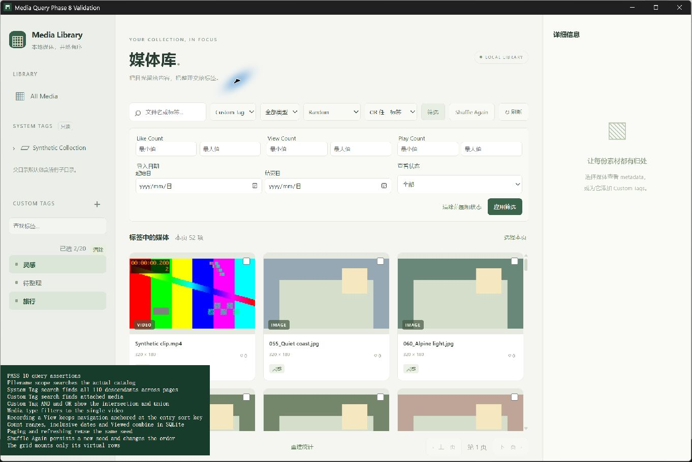

# Phase 8 验证记录

2026-11-10 在 Windows x64 和 WebView2 上验证。查询夹具均由临时数据库或工作区的 `.tools/validation/phase8` 生成。

## 性能与正确性

真实 SQLite 夹具含 100,000 个媒体 ID。每页 100 项，普通和 Random 分别遍历 1,000 页。两轮都精确返回 100,000 项，无重复或遗漏。Random 首次时间包含 SHA-256 排名和临时索引构建，后续 999 页纳入热分页统计。

| Desktop 配置 | 首次建索引及首页 | 分页 p50 | 分页 p95 | 末页 |
| --- | ---: | ---: | ---: | ---: |
| Imported ↓ | — | 0.851 ms | 1.261 ms | 0.850 ms |
| Random | 1,562.122 ms | 1.422 ms | 1.950 ms | 1.100 ms |

组合用例同时使用标签文字搜索、System Tag、Custom Tag、媒体类型、Like Count、导入时间和未查看状态，精确匹配 2,001 项。首页 3.259 ms，完整 21 页 84.266 ms。数字来自本机合成库的同次 desktop 测试。

无桌面配置复测的普通分页 p95 为 1.295 ms。Random 首次构建及首页为 1,507.979 ms，热分页 p95 为 2.590 ms，末页为 2.097 ms。组合筛选首页 2.988 ms，完整 21 页 74.868 ms。

对实际生成的 keyset SQL 执行 EXPLAIN QUERY PLAN。15 种排序的两个 seek 方向及类型组合索引均使用索引范围查询。排序用例包含并列值、文件名大小写、缺失时间、反向导航和游标失效。随机用例确认相同 seed 跨连接和过滤复用，新增媒体后已有媒体相对次序保持稳定，旧 seed 游标被拒绝。

前端运行 100,000 项虚拟窗口边界测试，另在 111 项的隔离桌面库确认 100 项页面只挂载虚拟窗口中的卡片。搜索采用字面子串，字母大小写按 SQLite ASCII 规则处理。导入日期按本地日历包含起止日。缺失时间按最早值排列，Custom Tag 多选上限 20。

## 桌面回归

真实产品入口通过 `tests/ui/query.html?run=1` 使用独立 `com.mediamanager.validation.phase8` 标识和工作区内的运行目录。使用 `seed_library_validation --phase8` 生成 111 个合成媒体及缩略图。

真实 Tauri IPC 验收通过 10 项。包括三个搜索范围、110 个目录后代跨页、Custom Tag 交集 8 项及并集 52 项、媒体类型、计数及日期和查看状态组合、Recently Viewed 导航锚点、分页与刷新稳定 seed、Shuffle Again 和虚拟窗口。调整日期输入的布局后重跑通过。

## 自动测试与清理

| 实际执行命令 | 结果 |
| --- | --- |
| `npm.cmd test` | 48/48 |
| `npm.cmd run build` | 严格 TypeScript 和生产前端构建通过 |
| `npm.cmd run test:dev` | 1/1 |
| `cargo test --locked --offline -- --include-ignored --nocapture` | 默认 desktop 配置 70/70 |
| `cargo test --no-default-features --locked --offline -- --include-ignored --nocapture` | 无桌面配置 70/70 |
| `cargo clippy --all-targets --locked --offline -- -D warnings` | 通过 |
| `cargo clippy --all-targets --no-default-features --locked --offline -- -D warnings` | 通过 |
| `cargo fmt --all -- --check` 和 `git diff --check` | 通过 |

Rust 测试使用工作区的 Cargo 缓存和真实 FFmpeg 9.0.2。关闭测试窗口后桌面 CLI 正常退出，1420 复查无连接或监听记录，截图会话已重置。
