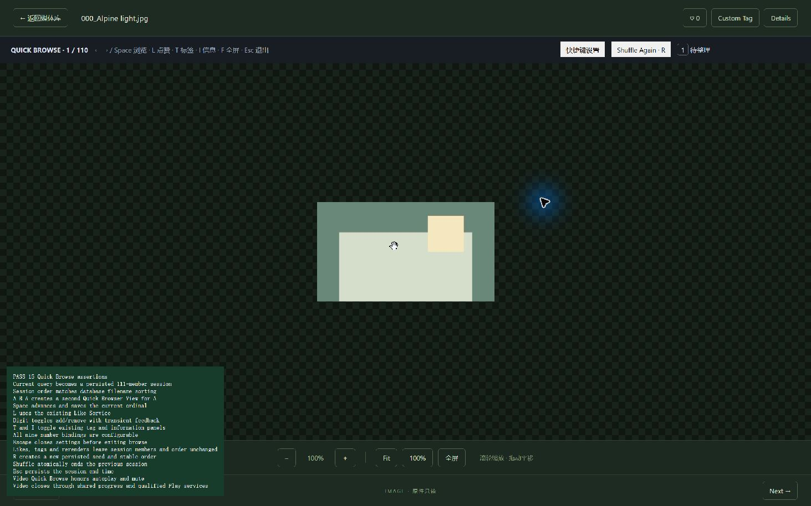

# Phase 9 验证记录

2026-11-11，Windows x64 / WebView2。沿用 rustc/cargo 1.99.1、Node 24.22.2、npm 11.19.1，以及工作区 FFmpeg/ffprobe 9.0.2；未升级依赖或改动锁文件。

## 完整测试

| 实际执行命令 | 结果 |
| --- | --- |
| `npm.cmd test` | 52/52 |
| `npm.cmd run test:dev` | 1/1 |
| `npm.cmd run build` | TypeScript 严格检查和生产构建通过 |
| `cargo test --locked --offline -- --include-ignored --nocapture` | desktop 78/78，真实 FFmpeg 用例全部执行 |
| `cargo test --no-default-features --locked --offline -- --include-ignored --nocapture` | 无桌面 78/78，真实 FFmpeg 用例全部执行 |
| `cargo clippy --all-targets --locked --offline -- -D warnings` | 通过 |
| `cargo clippy --all-targets --no-default-features --locked --offline -- -D warnings` | 通过 |
| `cargo fmt --all -- --check`、`git diff --check` | 通过 |

Rust 使用 `.tools/cargo-validation` 的离线缓存，真实媒体测试只使用临时目录和合成媒体。8 项新增后端场景覆盖 15 种排序/组合过滤快照、活动/标签后稳定顺序、新 seed/父会话原子结束及请求冲突、数字标签添加/移除/重试/事务回滚、缺失和内容变更保留 ordinal、共享 Quick View/Like、取消/超时/磁盘配额/缓存错误恢复、后台中断恢复、空列表、部分发布的有界清理和规模查询。4 项新增前端测试覆盖快捷键、快速 Toggle 队列/同请求重试、activation 和 IPC 边界。

首轮 Rust 新用例有一处夹具把 `media_revisions` 写成不存在的表名，已修正；Clippy 的可合并条件已修正，最终两种完整配置全部重跑通过。未删除或跳过断言。

## 100,001 成员实测

| 指标 | Desktop | 无桌面 |
| --- | ---: | ---: |
| 冻结源读，期间并发 Like/新增提交 | 138.097 ms | 131.847 ms |
| Random 构建及发布 100,001 个成员 | 10,152.037 ms | 8,939.795 ms |
| 发布批次 | 101，最大 1,000 项 | 101，最大 1,000 项 |
| 200 项分页 p50 | 2.715 ms | 1.657 ms |
| 200 项分页 p95 | 3.243 ms | 2.817 ms |

源读测试流式读取 100,000 项，首项读出后另一连接新增媒体和 Like；两次写入成功，当前源快照仍精确返回原 100,000 项。后续新 session 包含 100,001 项，逐页校验连续 ordinal、每个 ID 仅一次，EXPLAIN 确认使用 (session_id,ordinal) 索引范围查询。所有完整媒体对象未进入前端或构建集合；后端发布只保存一批 ID/版本。

构建后整个合成数据库约 85.5 MB（含媒体、索引、会话及其他 Schema，并非仅会话大小）。spool 文件已经回收。默认 spool 配额 512 MiB、页缓存 4 MiB、源读 120 秒，取消和超时可中断源 SQLite 工作；已发布会话按元数据保留，不宣称全历史总磁盘配额、峰值进程内存或长期保留期已经验收。

## 真实桌面回归

`seed_library_validation --phase9` 在 `.tools/validation/phase9` 生成 110 张图片、一个视频和缩略图，使用独立 identifier/runtime。`tests/ui/quick-browse.html?run=1` 挂载真实产品 App，通过正式 Tauri IPC 完成 15 项断言：当前查询与固定排序、A→B→A、Space、统一 Like、数字标签双向切换和反馈、T/I、九个绑定、设置内 Esc、活动后顺序不变、R 新 seed 与结束父会话、Esc 生命周期、静音自动播放及视频退出保存。

首轮 UI 夹具错误地读取了背景 Grid 的 Like 按钮，已限定为当前 viewer；后续发现视频退出由父子各 flush 一次，第二次写入已释放 owner。已修复为 flush → 释放资源 → 结束会话，完整 15 项重跑通过，视频退出回归保留。

另通过原生键盘输入验证 F 进入窗口全屏，Space 在全屏中切换到第二项，Esc 退出 Quick Browse 并恢复普通窗口。截图保存完整窗口图像。

退出后只读查库，19 条 View 全部为 quick_browser，三个 Counter Cache 与日志计数零差异。调试阶段强制 WebView reload 的旧会话留有未结束记录；最终正常 Esc 会话均有 ended_at。异常进程中止/强制重载不虚构结束时间，本轮未增加历史恢复 UI。用户原件没有进入写入或删除路径。

Alt+F4 后 desktop CLI exit 0，确认目标测试窗口不存在；1420 最终无 Listen（退出初次检查只有 OS TIME_WAIT），截图内核已重置。前端开发监听回归单独启动的服务也已正常退出。不推进后续 Phase。
